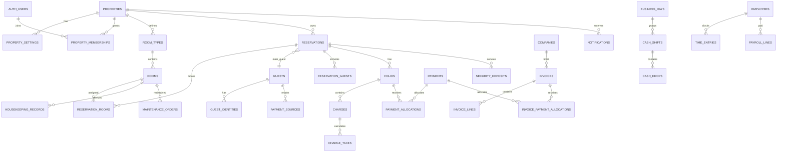

# Hotel PMS — Target Database Schema

Status: **Approved target schema** — owner approval is recorded in `docs/approval.md`; production migrations remain subject to the rules in `docs/rules.md`.

## 1. Modeling rules

- PostgreSQL UUID primary keys; UTC timestamps; property-local business dates.
- Every tenant-owned root row contains `property_id`; database RLS enforces isolation.
- Money is integer minor units with `currency_code`; never floating point.
- Financial records use explicit status and reversal/refund links. The PRD permits authorized permanent payment deletion, but referential checks must prevent orphaned allocations/refunds.
- Closed business-day data is immutable.

## 2. Entity relationship overview

## 3. Identity and tenancy

- `properties`: identity, address, country, timezone, default currency, logo, check-in/out time, status.
- `property_settings`: typed/versioned settings including tax, document format, due days, cash float, Night Audit schedule, and rules version.
- `auth_users`: authentication identity; provider-managed password credentials.
- `property_memberships`: user, property, role, active state. Unique user/property; v1 limits one active property membership per user.
- `employees`: property employee profile, job role, pay method/rate, active state; optionally linked to membership.

## 4. Inventory, guests, and reservations

- `room_types`, `rooms`, `room_blocks/out_of_order_periods`, `floor_map_items`. Each room stores its Smoking/Non-Smoking designation.
- `guests`: canonical profile and DNR state.
- `guest_identities`: ID type/number normalized hash/key, metadata, storage object, captured/expiry/deletion dates. Unique `(property_id, normalized_id_type, normalized_id_number)` drives automatic merge.
- `guest_merge_events`: surviving ID and merged IDs for operational recovery/reference without exposing deleted duplicates.
- `guest_payment_sources`, `guest_remarks`, `guest_vehicles`. `guest_remarks` stores one immutable row per remark with its own creation timestamp so new remarks append instead of overwriting history.
- `reservations`: main guest, company, source, status, dates, stored tax snapshot, currency, group flag, notes.
- `reservation_rooms`: one row per room in a single/group booking; room type, assigned room, dates/status, checkout state.
- `reservation_guests`: guest membership and room association.
- `nightly_rates`: reservation-room/date/base rate/promotion discount/final rate.
- `booking_sources`, `promotions`, `reservation_promotions`, `room_moves`, `registration_signatures`, `rules_versions`.
- Availability uniqueness/exclusion constraints prevent overlapping active assignments and room-type inventory overbooking is checked transactionally.

## 5. Ledger, documents, and payments

- `document_sequences`: property format/prefix/current sequence/reset policy shared by folios and invoices.
- `folios`: reservation, optional reservation room, number, state, sent date.
- `charges`: folio, reservation room, service date, type, description, quantity, amount, taxable, status.
- `charge_taxes`: linked charge, tax name/rate snapshot/amount/manual override reason.
- `payments`: property, reservation/company, method, amount, date, card metadata, external reference, status.
- `payment_allocations`: payment-to-folio amount.
- `refunds`: original payment, amount, method/date/reason. Sum cannot exceed original amount.
- `security_deposits`: reservation room, method (cash/authorization), amount, status, optional-print flag.
- `deposit_deductions` and `deposit_releases`: amount/reason/note/timestamp; total cannot exceed deposit.
- `bad_debts`: folio/amount/reason/date and related settling allocation.

## 6. Companies and accounts receivable

- `companies`, `company_contacts`, `company_room_rates`.
- `invoices`: company, shared document number, due date, status, sent date, currency, group reservation link.
- `invoice_lines`: references source folio/charge for traceability.
- `invoice_payment_allocations`: company payment-to-invoice allocation.
- `company_credits` and `company_credit_allocations`: overpayment balance and staff-directed use.
- `invoice_reminders`: due/reminder state and seven-day schedule.

## 7. Operations and staff accounting

- `housekeepers`: non-login worker identity where not represented by login employees.
- `housekeeping_records`: room/date/service context, cleanliness status, assigned housekeeper, completed marker.
- `maintenance_orders`: problem, priority, assigned worker, cost, rentable flag, status, dates.
- `attachments`: property-scoped polymorphic metadata for maintenance photos/receipts, expense receipts, IDs, and logos.
- `time_entries`: employee/date, separately recorded or manually editable clock in/out and break start/end, derived unpaid break minutes, and correction note.
- `payroll_periods`, `payroll_lines`, `piecework_items`, `payroll_payments`.
- `vendors`, `expense_categories`, `expenses`, `recurring_expense_rules`.
- `business_days`: property/date/status, opened/closed times; unique property/date.
- `cash_shifts`: business day, employee, opening/expected/counted/float/status.
- `cash_transactions`: payment/refund/expense/manual supported ledger link.
- `cash_drops`: shift/drop amount/time. Over/short derives from ledger and count; no manual over/short columns.

## 8. Platform services

- `notifications`: property, recipient role/user, type, related resource, read/resolved timestamps.
- `scheduled_jobs`: idempotency key, property, job type, scheduled/run state, attempts/error.
- `saved_reports`: owner, filters, columns, grouping, visibility.
- `backup_jobs` and `restore_jobs`: manifest version, state, file reference, validation result.
- `import_jobs` and `import_errors`: guest CSV/XLSX processing and row errors.

## 9. Required constraints and indexes

- Tenant-leading indexes: `(property_id, status/date/search-key)`.
- Unique hotel room number, guest normalized ID, document number, company normalized name where appropriate.
- Check constraints: nonnegative amounts/quantities; valid date ranges; refund/deposit allocation ceilings.
- Foreign keys restrict deletion while dependent financial/deposit activity exists.
- Search indexes cover guest name/ID/phone, confirmation, room, company, folio, and invoice.
- Version/`updated_at` supports optimistic concurrency.
