# Hotel PMS — User Flows

Status: **Approved** — owner approval recorded in `docs/approval.md`. These diagrams describe required behavior, not current implementation.

## 1. Reservation to checkout

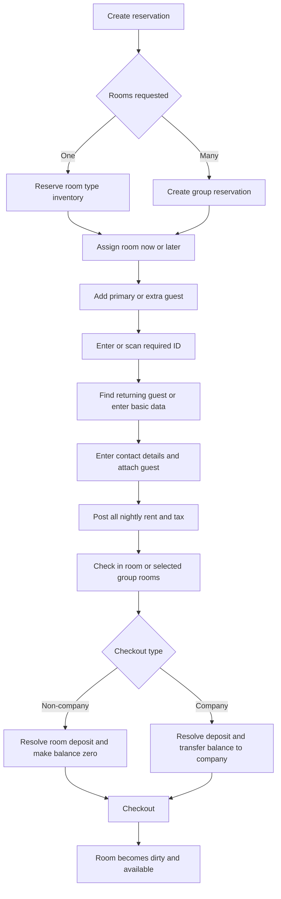

### Cancel, No Show, and reinstate

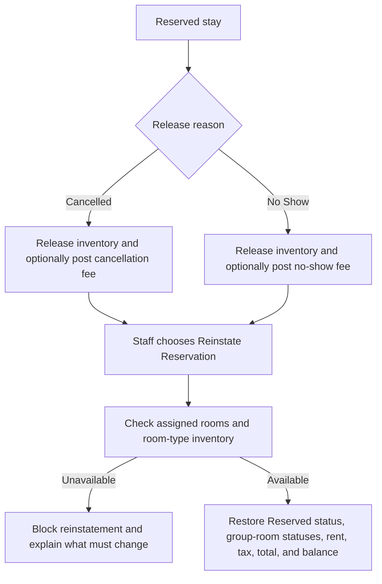

## 2. Group partial checkout

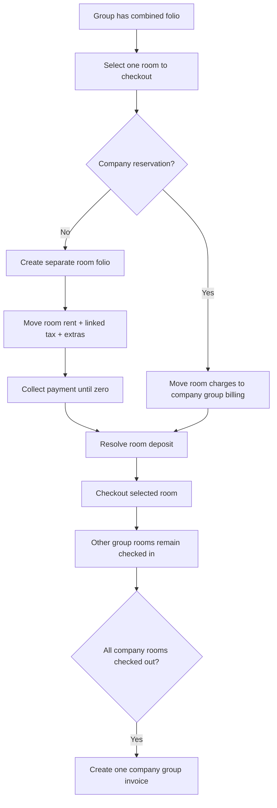

## 3. Room move

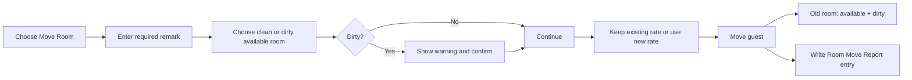

## 4. Folio, payment, and deposit

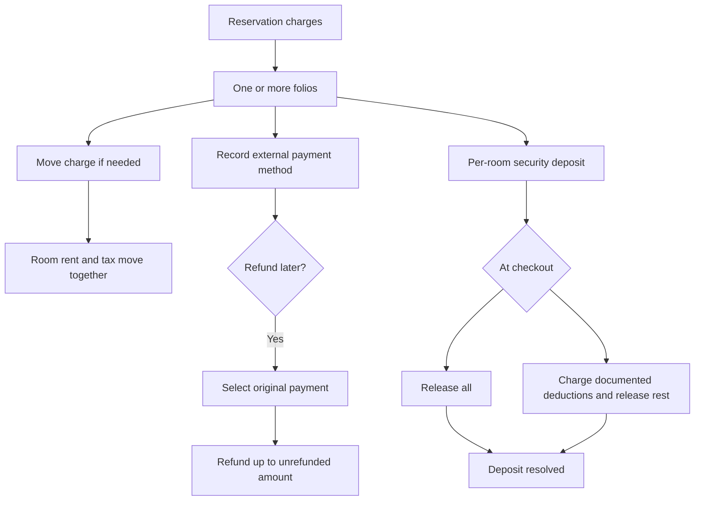

## 5. Company invoicing and allocation

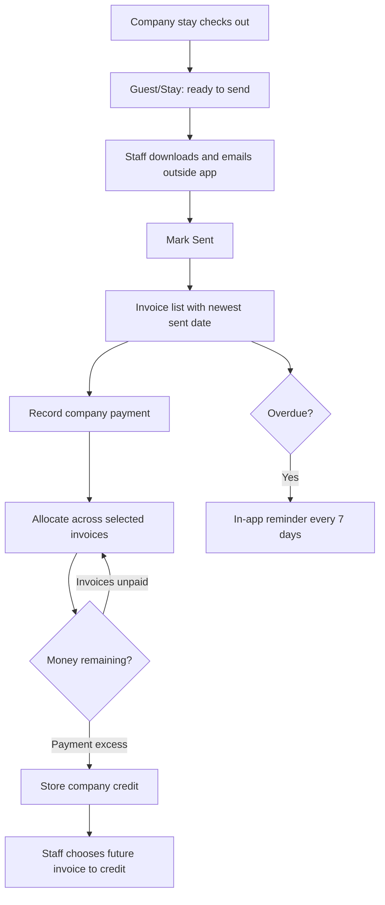

## 6. Cash shift

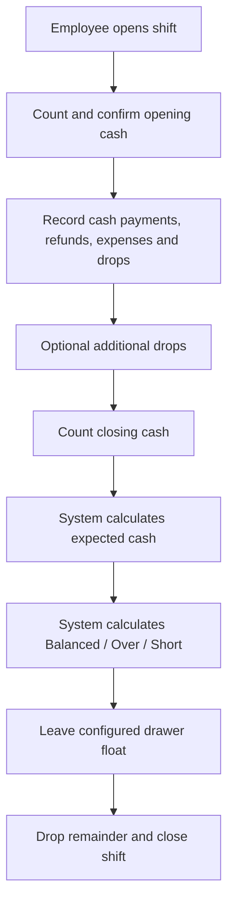

## 7. Maintenance and housekeeping

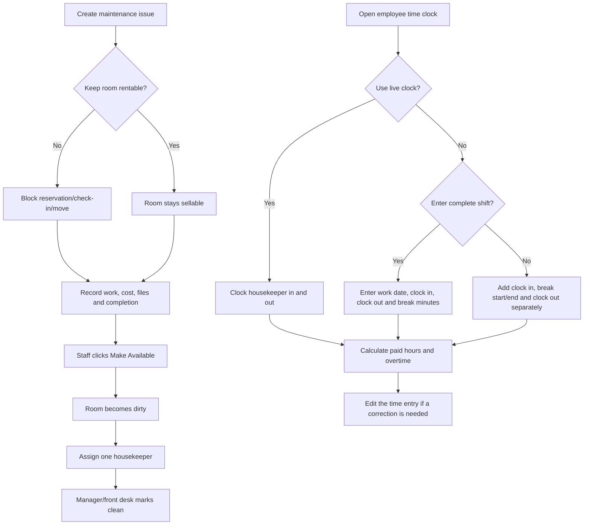

## 8. Night Audit

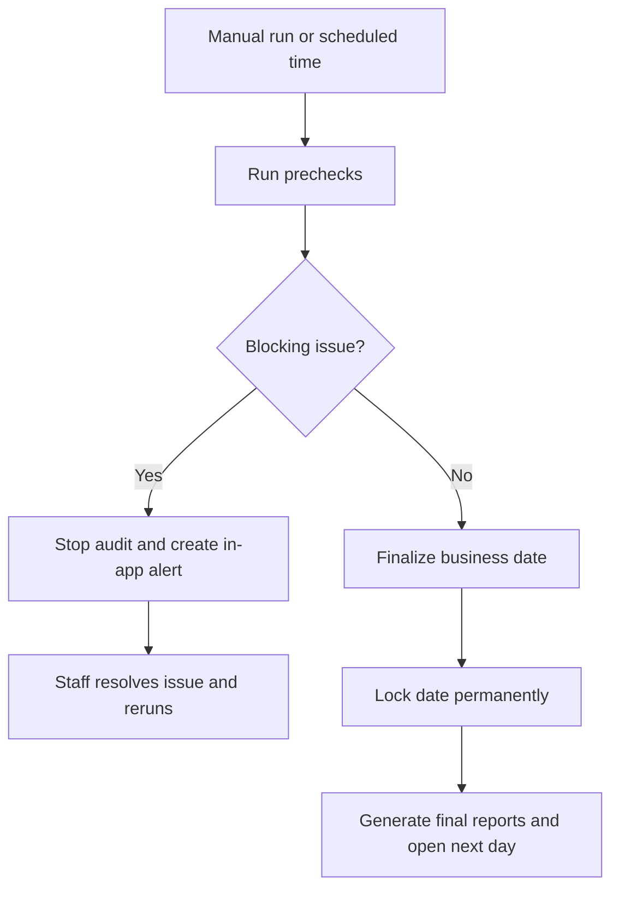

## 9. Guest merge and ID retention

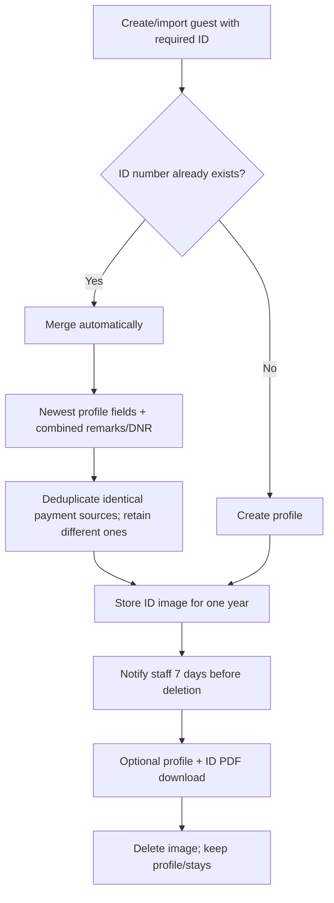

## 10. Backup restore

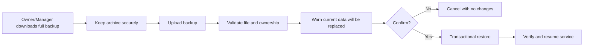
